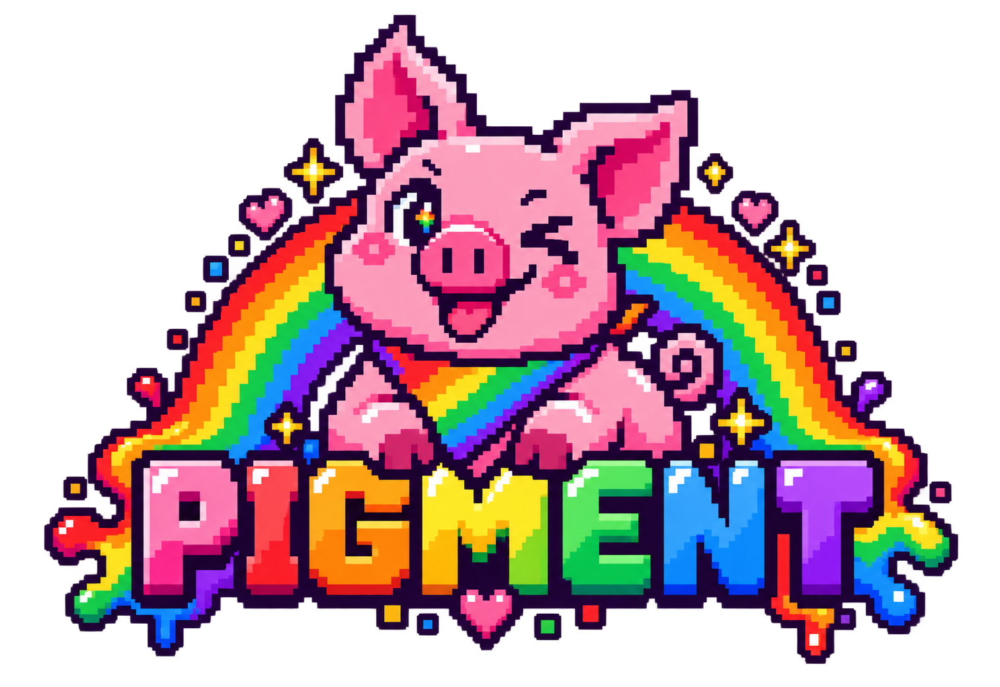

# Pigment



Pigment brings raster image loading and SVG rendering into one C project for
Linux and Unix. It provides the GdkPixbuf and librsvg interfaces that existing
applications already use. You shouldn't need a new image API just to put a
picture on the screen.

## The name is new. The library names aren't.

Under the hood, Pigment combines code from GdkPixbuf and librsvg into a shared
source tree and Meson build. It handles pixel buffers, image decoding, scaling
and compositing, and SVG rendering through Cairo.

Applications still use `gdk-pixbuf-2.0` and `librsvg-2.0`, along with their
existing headers, library names and loader interfaces. SVG support is optional:
a raster-only build doesn't pull in the SVG renderer's dependencies. GTK is a
downstream consumer, not a requirement for building the libraries.

The work is about keeping those familiar interfaces while retiring unchecked
code paths, untangling ownership and checking what actually gets rendered.

## Try a build

You'll need a C compiler, Meson 0.63 or newer, Ninja, pkg-config and the
development packages for the enabled libraries. The default build uses
GLib/GObject/GIO, shared-mime-info, libpng and libjpeg. SVG adds Cairo, Pango,
HarfBuzz, Fontconfig, libxml2 and liblexa. Meson checks the required versions;
dependencies come from your system, not a download hidden inside the build.

```sh
meson setup build --wrap-mode=nofallback
meson compile -C build
```

For just the raster side:

```sh
meson setup build-raster -Dsvg=false --wrap-mode=nofallback
meson compile -C build-raster
```

GObject Introspection is detected automatically when available. Use
`-Dintrospection=enabled` to require it, or `-Dintrospection=disabled` to leave
it out. See [meson_options.txt](meson_options.txt) for codec and loader options.

## Before replacing anything

Pigment is under active development. Compatibility and rendering checks are
ongoing; it does not claim complete SVG/CSS coverage or parity with the latest
upstream librsvg. Linux/Unix is the target, not a promise that every Unix
platform has been tested. Windows is not supported.

**Don't install it over your system libraries by hand.** Pigment deliberately
uses the same installed paths as GdkPixbuf and librsvg. Replacement needs
coordinated packaging, not two providers writing the same files.

## Roots and licenses

Pigment builds on the work of the GdkPixbuf and librsvg contributors. Their
copyright notices and license terms stay with the code.
See [COPYING](COPYING), [COPYING.librsvg](COPYING.librsvg) and the individual
source files; libraries, utilities and artwork do not all share a blanket
license.
